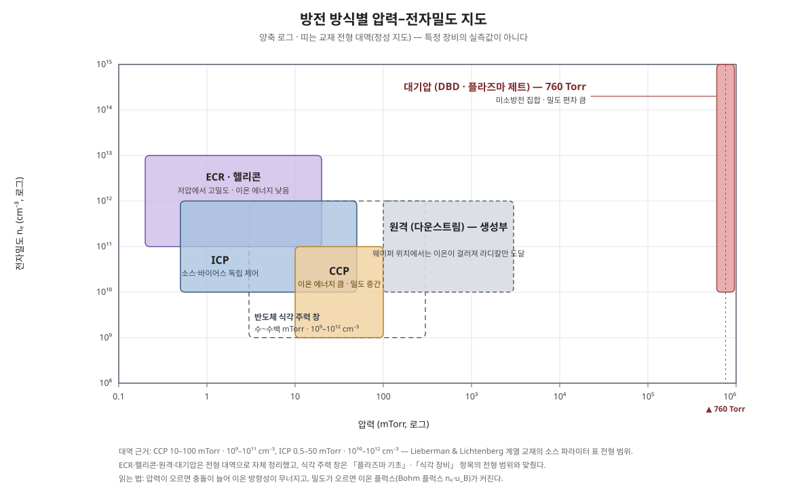

> 기체에 에너지를 가해 이온·전자·라디칼·중성종이 공존하게 된 상태 — 플라즈마의 구성원과 기본 성질.

플라즈마 식각은 라디칼의 화학 반응과 이온의 방향성 에너지를 결합해, 원하는 막만 수직으로 깎는 기술이다. 둘을 따로 쓰면 각각 느리거나 선택비가 없지만, 함께 쓰면 식각 속도가 합보다 훨씬 커지는 **이온–라디칼 시너지**가 핵심이다.

## 개요 — 약하게 이온화된, 평형이 아닌 기체

공정 플라즈마는 기체에 RF·마이크로파 전력을 가해 만든 **저온·약전리 플라즈마**다. 중성 기체가 대부분을 차지하고, 이온화된 비율은 대략 10⁻⁴~10⁻² 수준에 불과하다. 그런데도 전기적 거동은 하전 입자가 지배한다 — 전자가 가볍고 빠르기 때문이다.

가장 중요한 특징은 **비열평형**이다. 전자온도 Tₑ는 1~10 eV(온도로 환산하면 약 1만~10만 K)이지만, 이온과 중성 기체의 온도는 상온 부근(수백 K, 0.03~0.1 eV 수준)에 머문다. RF 전기장은 가벼운 전자만 따라 흔들며 에너지를 주고, 무거운 이온·중성은 충돌로도 그 에너지를 거의 나눠 받지 못한다. 덕분에 웨이퍼와 챔버를 녹이지 않으면서도, 전자만큼은 수 eV~수십 eV의 화학 반응(해리·이온화)을 일으킬 에너지를 갖는다. 플라즈마 공정이 "차가운데 반응성이 높은" 이유가 여기에 있다.

### 플라즈마 안에 있는 것

| 입자 | 역할 | 방향성 |
| --- | --- | --- |
| 전자 | 기체 분자를 때려 이온·라디칼 생성 (에너지 공급원) | — |
| 이온 (Ar⁺, CFₓ⁺, Cl⁺ 등) | 시스 전기장으로 가속되어 웨이퍼에 수직 충돌 → 표면 활성화, 스퍼터 | 강함 (수직) |
| 라디칼 (F, Cl, O, CFₓ 등 중성) | 표면과 화학 반응해 휘발성 생성물을 만듦, 폴리머 증착 | 없음 (등방) |
| 광자 (UV/VUV) | 결합 절단, 손상 유발 | 없음 |
| 중성 기체 분자 (CF₄, Cl₂, O₂ 등) | 전체 입자의 대부분. 전자와 충돌해 이온·라디칼의 재료가 됨 | 없음 (등방) |
| 들뜬 종·준안정종 | 충돌로 에너지를 품은 중성종. 다른 분자와 부딪혀 이온화·해리를 돕고, 바닥으로 떨어지며 빛을 냄 ([[OES]]가 읽는 신호) | 없음 |
| 음이온 (F⁻, Cl⁻ 등) | 전기음성도가 큰 가스에서 생기는 음전하 종. 벌크에 갇혀 있다가 펄스 오프 구간 등에 표면에 닿아 거동을 바꿈 | 약함 (벌크에 구속) |

밀도 감각도 잡아 두자. 수~수십 mTorr 공정 압력에서 중성 기체 밀도는 10¹⁴~10¹⁵ cm⁻³ 수준이고, 전자밀도 nₑ는 10⁹~10¹² cm⁻³이다. 즉 전자는 중성 10만~100만 개당 하나꼴이지만, 그 하나가 나머지 전체의 반응을 연쇄로 일으킨다.



## 원리 1 — 준중성과 디바이 길이

벌크 플라즈마는 양전하와 음전하가 거의 같은 **준중성(quasi-neutrality)** 상태다: nᵢ ≈ nₑ (+ 음이온이 많으면 nᵢ ≈ nₑ + n₋). 어느 한쪽 전하가 국소적으로 쏠리면 강한 전기장이 즉시 생겨 쏠림을 되돌리기 때문이다.

이 차폐가 미치는 거리가 **디바이 길이(Debye length)** 다.

```latex
\lambda_D = \sqrt{\frac{\varepsilon_0 k T_e}{n_e e^2}}
```

전형 조건(Tₑ ≈ 3 eV, nₑ ≈ 10¹¹ cm⁻³)에서는 λ_D가 수십 µm 수준이다. 계의 크기가 λ_D보다 훨씬 클 때만 준중성이 성립하고 "플라즈마"라고 부를 수 있다. 반대로 벽 근처 λ_D 수 배 두께의 얇은 층에서는 준중성이 깨지는데, 그 층이 바로 아래에서 다룰 **쉬스(sheath)** 다. λ_D가 작을수록 플라즈마는 벌크가 넓고 쉬스가 얇아진다 — 밀도를 올리면 쉬스가 얇아지는 이유다. λ_D의 실측 맥락은 [[랭뮤어 프로브]] 항목을 참고하라.

## 원리 2 — 쉬스: 왜 생기고, 이온을 어떻게 가속하나

플라즈마가 벽·웨이퍼·전극에 닿으면 표면에 양전하 층인 쉬스가 선다. 형성 이유는 **이동도 차이**다. 질량이 이온의 수만 분의 일인 전자는 열속도가 훨씬 빠르므로, 처음에는 전자가 벽에 훨씬 많이 쏟아진다. 벽(또는 부유한 웨이퍼 표면)은 음으로 대전되고, 그 전위가 전자를 밀어내 이온 흐름과 전자 흐름이 같아지는 지점에서 균형이 잡힌다. 결과적으로 **플라즈마 벌크는 항상 벽보다 양(+)의 전위**에 있고, 그 전위차의 대부분이 쉬스 안에 집중된다.

- **전위 강하 크기** — 외부에서 전압을 걸지 않은 부유 표면 기준으로, 쉬스 전압은 대략 전자온도의 수 배 수준이다. Ar 플라즈마에서는 플라즈마 전위와 부유 전위의 차가 대략 5 × Tₑ(eV) 수준의 전압(V)으로 주어진다는 것이 교과서 전형 관계다([[랭뮤어 프로브]]의 전위 관계와 같은 식이다). 바이어스 전력을 걸면 이 강하에 바이어스분이 더해져 수십~수백 V까지 커진다.
- **이온 가속** — 이온은 쉬스를 가로지르며 전위 강하에 해당하는 에너지(e × 쉬스 전압)를 얻어 표면에 거의 수직으로 충돌한다. 쉬스 안에서는 중성과의 충돌이 적을수록(저압일수록) 방향성과 에너지가 잘 유지된다. 그래서 이온 에너지의 조절 손잡이는 바이어스 전력이, 이온 양(플럭스)의 손잡이는 플라즈마 밀도(소스 전력)가 맡는 분업이 성립한다 — 장비별 구현은 [[식각 장비]] 참고.
- **전자 차단** — 쉬스 전위 장벽보다 에너지가 낮은 전자는 표면에 닿지 못한다. 표면 화학을 전자가 아니라 이온과 라디칼이 주도하게 되는 구조적 이유다.

쉬스는 탐침·벽·웨이퍼를 가리지 않고 모든 경계에 서며, 두께는 λ_D의 수 배에서, 고전압 바이어스 조건에서는 Child–Langmuir 법칙을 따라 전압^(3/4)에 비례해 두꺼워진다.

## 원리 3 — 보옴 기준 (Bohm criterion)

쉬스가 안정적으로 서려면 이온이 쉬스 경계에 **이미 일정 속도 이상으로 들어와야** 한다. 이온이 너무 느리면 쉬스 입구에 양전하가 쌓여 전위 구조가 무너지기 때문이다. 이 하한이 **보옴 속도(Bohm velocity)** 다.

```latex
u_B = \sqrt{\frac{k T_e}{m_i}}
```

이온온도가 전자온도보다 훨씬 낮은(Tᵢ ≪ Tₑ) 단일 이온종 기준의 식이다. 예로 Ar⁺(mᵢ ≈ 40 amu), Tₑ = 3 eV이면 u_B ≈ 2.7 km/s다. 벌크에서는 느리게 떠다니던 이온이 쉬스 앞의 완만한 전위 강하 영역(프리쉬스, presheath)에서 대략 kTₑ/2만큼의 에너지를 얻어 이 속도에 도달한 뒤 쉬스로 들어간다.

보옴 기준은 진단과도 직결된다. 쉬스에 들어가는 이온 플럭스가 nₑ × u_B로 정해지므로, 이온 포화전류로부터 밀도를 역산하는 [[랭뮤어 프로브]] 해석의 뼈대가 이 식이다. 반대로 말하면, 웨이퍼에 닿는 이온 플럭스는 바이어스를 세게 건다고 늘지 않는다 — 플럭스는 밀도와 Tₑ가 정하고, 바이어스는 에너지(속도의 쉬스 내 증가분)를 정한다.

## 원리 4 — 충돌 과정: 전자가 만드는 화학

플라즈마의 화학은 사실상 "전자 충돌의 목록"이다. 수 eV 전자가 중성 분자와 부딪혀 일으키는 과정은 다음으로 나뉜다.

| 충돌 과정 | 내용 | 결과 |
| --- | --- | --- |
| 탄성 충돌 | 전자가 에너지를 거의 잃지 않고 방향만 바꿈 | 전자 에너지 분포의 등방화, 기체 가열은 미미 |
| 여기 (excitation) | 분자·원자를 들뜬 상태로 올림 (문턱 대략 수 eV~) | 들뜬 종이 떨어지며 발광 → [[OES]] 신호의 근원 |
| 해리 (dissociation) | 분자 결합을 끊어 라디칼 생성 (예: CF₄ → CF₃ + F) | 식각·증착을 실제로 수행하는 라디칼 공급 |
| 이온화 (ionization) | 전자를 떼어내 이온 + 전자 생성 (문턱 대략 10수 eV, Ar 기준 15.8 eV) | 플라즈마 유지의 핵심 — 손실된 전하를 보충 |
| 해리성 부착 | 전자가 분자에 붙으며 갈라져 음이온 생성 | 전기음성 가스(FC·Cl 계열)에서 음이온 형성 |
| 재결합·전하교환 | 이온이 전자를 얻거나 중성과 전하를 맞바꿈 | 하전 입자 소멸, 빠른 중성종 생성 |

핵심은 **문턱의 순서**다. 평균 전자 에너지(수 eV)는 이온화 문턱(10수 eV)보다 한참 낮다. 그런데도 이온화가 유지되는 것은, 전자 에너지분포의 **고에너지 꼬리**에 든 소수 전자가 문턱을 넘기 때문이다. 그래서 분포의 꼬리 모양이 플라즈마 전체의 이온화율·해리율을 좌우한다.

충돌 빈도를 가늠하는 양이 **평균자유행로(mean free path)** λ = 1/(n_g σ) (n_g는 중성 밀도, σ는 충돌 단면적)다. 공정 압력 수~수십 mTorr에서는 전자의 평균자유행로가 cm~수십 cm 수준으로 챔버 크기와 견줄 만하고, 이온도 쉬스 두께와 견줄 만한 수준이다. 이 "충돌이 드문" 조건 덕분에 이온은 쉬스에서 방향을 잃지 않고, 라디칼은 벽에 몇 번 부딪히며 웨이퍼까지 수송된다. 압력을 올리면 충돌이 잦아져 이온 방향성이 무너지고(등방화), 기상 반응·파티클 생성 쪽으로 거동이 기운다 — 압력이 식각 프로파일의 손잡이인 이유다.

## 원리 5 — 전자 에너지분포함수 (EEDF)

전자 전체가 하나의 온도로 기술되는 경우는 이상에 가깝다. 실제 분포함수 f(E)의 모양은 방전 방식과 압력에 따라 달라진다.

- **맥스웰 분포 (Maxwellian)** — 전자–전자 충돌이 잦아 에너지 교환이 충분히 일어나면 성립하는 열평형형 분포. 하나의 Tₑ로 기술된다. 고밀도·비교적 고압 조건에서 가깝다.
- **드루베스테인 분포 (Druyvesteyn)** — 탄성 충돌이 지배적이고 전기장으로 얻는 에너지가 충돌마다 조금씩 새는 조건의 분포. 맥스웰형보다 고에너지 꼬리가 가파르게 떨어진다. 저압 방전에서 자주 이쪽에 가깝다.
- **이중 맥스웰 (bi-Maxwellian)** — 저압 용량결합 방전 등에서는 차가운 전자군과 뜨거운 전자군이 섞인 두 기울기 분포가 나타나기도 한다.

실무적 함의는 하나다: 이온화·여기 같은 문턱 반응의 속도계수는 분포 꼬리에 지수적으로 민감하므로, 같은 평균 에너지라도 분포 모양이 다르면 라디칼·이온 조성이 달라진다. 그래서 "전자온도 몇 eV"라는 한 숫자는 개략 지표일 뿐, 정량 해석에서는 분포 자체가 필요하다. 분포를 실험으로 뽑는 법(2차 미분법)은 [[랭뮤어 프로브]]에서 다룬다.

## 핵심 수치

| 항목 | 전형값 (공정 플라즈마) |
| --- | --- |
| 전자온도 Tₑ | 약 1~10 eV (방전 방식 따라 다름) |
| 전자밀도 nₑ | 약 10⁹~10¹² cm⁻³ (CCP 하단 ~ ICP·ECR 상단) |
| 이온·기체 온도 | 상온 부근 (수백 K, 0.1 eV 이하 수준) |
| 이온화율 | 대략 10⁻⁴~10⁻² (약전리) |
| 디바이 길이 λ_D | 전형 조건에서 수십 µm 수준 |
| 쉬스 두께 | λ_D의 수 배 (고바이어스에서는 더 두꺼움) |
| 보옴 속도 (Ar⁺, Tₑ=3 eV) | 약 2.7 km/s |
| 부유 표면의 쉬스 전압 (Ar) | 대략 5 × Tₑ 수준 (V) |
| 이온화 문턱 (Ar) | 15.8 eV |

## 트레이드오프와 한계

- **밀도 vs 에너지 독립 제어의 한계** — 소스 전력(밀도)과 바이어스 전력(에너지)을 나눈 분업은 유도결합 방식에서 가장 잘 성립하고, 용량결합 방식에서는 두 손잡이가 서로 얽힌다. 자세한 장비별 차이는 [[식각 장비]] 참고.
- **균일성** — 벌크 밀도 분포는 챔버 형상·가스 흐름·표면 재결합에 좌우된다. 중심과 가장자리의 밀도 차가 그대로 식각률 불균일로 번진다.
- **분포의 비맥스웰성** — 꼬리 하나에 반응 전체가 매달려 있어, 전력·압력을 조금만 바꿔도 조성 변화가 비선형으로 나타난다. 조건 창의 비선형성이 여기서 온다.
- **손상의 씨앗** — 쉬스를 건넌 이온 에너지와 UV/VUV 광자는 원하는 식각과 함께 격자 손상·전하 축적(차징)도 만든다. 이 비이상 거동은 [[식각 비이상 현상]]에서 이어서 다룬다.

## 관련 항목

- [[건식 식각]] — 플라즈마의 대표 응용
- [[단계별 플라즈마 지도]] — 공정 단계마다의 플라즈마 역할
- [[식각 장비]] — 이 플라즈마를 만드는 하드웨어
- [[랭뮤어 프로브]] — Tₑ·nₑ·전위를 숫자로 재는 법
- [[OES]] — 들뜬 종의 발광으로 종 조성을 읽는 법

## 근거

- 준중성·디바이 길이·쉬스·보옴 기준·EEDF와 전형 수치 범위는 플라즈마 공정 표준 교재의 전형값이다: Lieberman & Lichtenberg, *Principles of Plasma Discharges and Materials Processing* (Wiley, 2nd ed., 2005); Chen, *Introduction to Plasma Physics and Controlled Fusion* (Springer, 3rd ed., 2016).
- Ar 이온화 문턱 15.8 eV는 원자 물성의 확정값이다. 보옴 속도 2.7 km/s는 위 보옴 식에 Ar 질량과 Tₑ = 3 eV를 넣은 계산값이다.
- 부유 전위 관계(약 5 × Tₑ)와 λ_D 수십 µm라는 감각은 [[랭뮤어 프로브]] 항목의 전형 조건과 맞춘 값으로, 진단 항목과 중복 서술을 피하고 링크로 연결했다.
