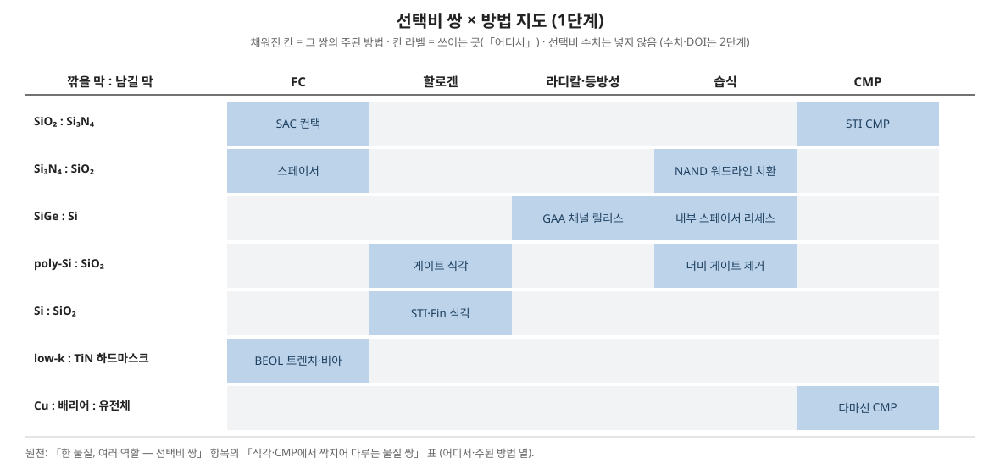

> 같은 물질이 공정에 따라 다른 역할을 한다는 것과, 식각 선택비가 언제나 물질 쌍으로 정해진다는 정리.

### 한 물질, 여러 역할 — 그리고 선택비 쌍

**네 물질의 쓰임 지도**

| 물질 | FEOL | MOL | BEOL | 메모리 / 패키징 |
| --- | --- | --- | --- | --- |
| Si | 기판, 채널, 나노시트, 에피 S/D | 실리사이드 형성 대상 | — | TSV가 관통하는 몸체, Si 인터포저 |
| SiO₂ | 게이트 IL, STI 갭필, 패드·스크린 산화막 | PMD | 층간 절연(구세대), TEOS 캡, 하드마스크 | ONO 터널/블로킹, NAND 몰드, TSV 라이너, 하이브리드 본딩면 |
| Si₃N₄ | STI 하드마스크·CMP 정지, 스페이서, 응력 라이너 | SAC 캡, CESL | 식각 정지(일부), 최상부 패시베이션 | 전하 트랩층, NAND 희생층 |
| SiGe | PMOS S/D 스트레서, GAA 희생층, PMOS 채널 | — | — | — |

**식각·CMP에서 짝지어 다루는 물질 쌍** — 한쪽을 깎고 다른 쪽을 남겨야 하는 조합들이다.

| 깎을 막 : 남길 막 | 어디서 | 주된 방법 |
| --- | --- | --- |
| SiO₂ : Si₃N₄ | SAC 컨택, STI CMP | FC 플라즈마(폴리머 균형), 세리아 슬러리 |
| Si₃N₄ : SiO₂ | 스페이서, NAND 워드라인 치환 | CH₃F/O₂ 플라즈마, 고온 인산 |
| SiGe : Si | GAA 채널 릴리스, 내부 스페이서 리세스 | 라디칼 기반 등방성 식각, 습식 |
| poly-Si : SiO₂ | 게이트 식각, 더미 게이트 제거 | HBr/Cl₂ 플라즈마, TMAH |
| Si : SiO₂ | STI·Fin 식각 | HBr/Cl₂/O₂ |
| low-k : 금속 하드마스크(TiN) | BEOL 트렌치·비아 | FC 플라즈마 |
| Cu : 배리어 : 유전체 | 다마신 CMP | 단계별 슬러리 |

이 쌍들의 선택비가 곧 공정 마진이 되므로, 새 물질이 들어올 때마다 "무엇과 짝지어 식각되는가"를 먼저 확인하는 것이 좋다.



### 선택비의 정의와 측정

선택비는 언제나 순서쌍으로 정의된다.

```latex
S_{A/B} = \frac{\text{ER}_A}{\text{ER}_B}
```

ER은 식각률, A는 깎을 막, B는 남길 막이다. S = 10이면 A가 10 nm 깎이는 동안 B는 1 nm 깎인다. 정의가 단순한 만큼 측정 조건이 숫자를 좌우한다.

- **블랭킷 측정** — 패턴 없는 막으로 각각의 식각률을 재는 기본값. 빠르고 재현성이 좋지만, 실제 패턴에서의 수송·패시베이션 차이는 담지 못한다.
- **패턴 측정** — 실제 구조에서 단면으로 잔막과 손실을 재는 값. 공정 마진 판단은 이쪽이 기준이다.
- **끝점·과식각과의 결합** — 선택비는 단독으로 쓰이지 않는다. 목표 깊이 D를 깎고 과식각 비율 f만큼 더 돌릴 때 하부막 손실은 대략 D(1 + f)/S로 정해진다(산술 관계). 마스크 두께 예산도 같은 식으로 역산한다: 허용 마스크 손실이 정해지면 필요한 최소 선택비가 나온다.

### 선택비의 두 기원

- **화학적 기원** — 반응 생성물의 휘발성과 결합 해리 경로가 물질마다 다른 데서 온다. 예컨대 F 화학에서 Si는 SiF₄로 날아가지만, 질소를 품은 막은 다른 경로(염 형성 등)를 탈 수 있다. 온도·라디칼 조성 같은 화학 변수에 민감하고, 잘 맞으면 매우 큰 선택비가 나온다.
- **물리적 기원** — 이온 에너지에 대한 스퍼터 임계값과 패시베이션 막 형성 속도의 차이에서 온다. FC 플라즈마에서 산화막 위 폴리머가 얇게 유지되고 질화막 위에서는 두꺼워지는 균형 차이가 대표적이다(Schaepkens 1999 계열의 고전적 그림). 에너지·압력 같은 물리 변수에 민감하며, 대개 화학적 선택비보다 작지만 이방성과 함께 얻어진다.

실제 공정의 선택비는 두 기원의 합성이다. 어느 기원이 지배적인지 알아야 조건을 바꿨을 때 선택비가 어느 방향으로 움직일지 예측할 수 있다.

### 선택비를 정하는 물리량 — 정량 축으로 다시 보기

두 기원의 이야기는 결국 네 개의 물리량 축으로 분해된다. 조건을 바꿀 때 선택비가 어느 방향으로 움직이는지는, 어느 축이 지배적인 공정인가로 예측한다.

**축 1 — 결합 에너지.** 깎을 막의 결합이 약하고 남길 막의 결합이 강하면, 같은 공격에 대한 응답이 갈린다. 결합 해리 에너지의 전형값(교재 전형값, kJ/mol)은 Si–Si 226, Si–Ge 약 205, Ge–Ge 188인 데 비해 Si–O는 452, Si–F는 565에 이른다. SiGe가 Si보다 빨리 깎이는 것([[리세스와 채널 릴리스]]), Si–O 결합이 강해 Cl 치환이 열역학적으로 불리한 것([[ALE (원자층 식각)]]의 방향성 창)은 이 축의 사례다. 단, 결합 에너지는 "끊기 쉬움"의 지표일 뿐 속도를 직접 주지는 않는다 — 실제 속도는 아래 축들과의 곱으로 정해진다.

**축 2 — 생성물의 휘발성.** 반응이 일어나도 생성물이 표면을 떠나지 못하면 식각은 멈춘다. 생성물의 끓는점이 곧 그 물질 조합의 "입장권"이다(물성 상수, °C): SiF₄는 상온에서 기체, SiCl₄ 58, GeCl₄ 83, SiBr₄ 154, WF₆ 17, TiCl₄ 136. 같은 Si라도 불소 화학이 염소 화학보다 자발 식각이 잘 되는 이유, Br 계열이 이온 보조 없이는 느린 이유가 이 축에 있다. 끓는점이 공정 온도 근처에 있는 생성물은 온도에 특히 민감해진다.

**축 3 — 온도.** 화학 식각률은 막마다 활성화 에너지가 달라, 온도를 움직이면 두 막의 속도비가 지수함수 비율로 변한다. 이온 보조가 지배하는 거동은 온도 의존이 약하므로, 온도 스캔에서 선택비가 크게 움직이면 화학적 기원이 지배적이라는 서명이 된다. 극단적인 사례가 극저온 ALE로, 온도를 내리자 응축층의 안정성이 갈리면서 SiO₂/SiN 선택 방향 자체가 역전했다(Hsiao et al. 2026, [[ALE (원자층 식각)]]). HCl 기상 식각의 SiGe 선택비가 저온에서 커지는 것도 같은 축이다([[리세스와 채널 릴리스]]).

**축 4 — 이온 에너지 임계.** 두 막의 스퍼터·개질 임계 에너지가 다르면, 이온 에너지를 그 사이에 놓는 것만으로 선택비가 생긴다. 문턱 아래에서는 개질된 층만, 위에서는 둘 다 깎인다. ALE의 에너지 창이 이 축의 극단적인 사용법이고, 연속 식각에서도 바이어스를 낮출수록 (물리적 기원의) 선택비가 오르고 속도가 떨어지는 트레이드오프가 이 축에서 온다. 임계값 자체는 대략 수십 eV 대에 몰려 있어 창이 좁다는 것이 이 축의 한계다.

**판정 사례를 이 틀에 놓으면** — AFS 화학의 Si₃N₄/SiO₂ 선택은 축 1·2의 화학적 기원에, 남길 막에서 반응 경로 자체가 성립하지 않는 자기제한이 겹친 경우다([[AFS 선택 식각]]). FC 폴리머 균형은 축 4 근처에서 패시베이션 두께 차이로 증폭되는 물리적 기원이다. Junige & George (2024)의 선택 역전은 네 축 어디에도 속하지 않는다는 점이 핵심이다 — 조건이 아니라 **표면에서 일하는 활성종 자체**(F⁻ → HF₂⁻)가 바뀌었다. 축으로 설명이 안 되는 선택비 변화는 종의 교체를 의심하라는 것이 이 사례의 교훈이다.

### 논문을 한 표에 모으면

선택비를 실제로 보고한 문헌을 쌍과 기원 축으로 모았다. 화학·장비·막이 행마다 달라 **행끼리 선택비 숫자를 비교하는 표가 아니다**. 같은 연구 안의 조건 변화(무첨가 → 첨가, 연속 → 펄스, 상온 → 극저온)가 선택비를 얼마나 움직였는지를 보는 표다. 조건·수치·그림 번호는 Joy의 원문 대조(자료 패키지 2차-2, 2026-11-01)를 따른다.

| 논문 | 깎을 막 : 남길 막 | 방법·조건 | 보고 값 | 주된 기원 축 | 원문 위치 |
| --- | --- | --- | --- | --- | --- |
| Shinoda 2016 | Si₃N₄ : SiO₂ | HFC 라디칼 노출 + 100~120 °C 어닐 사이클 | Si₃N₄ 2.6 nm/cycle, SiO₂는 검출한계 아래 (무한, 하한값) | 화학 — 남길 막에서 경로 부재 | 본문 · Fig. 5 |
| Volynets 2020 | Si₃N₄ : SiO₂ | NF₃/N₂/O₂/H₂ 리모트 플라즈마 | 약 380, H₂ 21 sccm에서 뾰족한 최대 | 화학 — H₂가 자유 F를 묶음 | I편 Fig. 3 (실험) · II편 Fig. 3 (모델) |
| Junige 2024 | SiNₓ : SiO₂ → SiO₂ : SiNₓ | TMA/HF 열 ALE 275 °C, 이어서 HF + NH₃ 공동 주입 | 무첨가 SiNₓ 1.06 · SiO₂ 0.20 Å/cycle (약 5 : 1) → 공동 주입 SiO₂ 8.83 Å/cycle · SiNₓ 약 0 (1000 : 1 초과, 방향 역전) | 활성종 교체 (F⁻ → HF₂⁻) | Fig. 8 · Fig. 11 · Fig. 12 |
| Hsiao 2026 | SiO₂ : SiN | HF + 에탄올 5 % 극저온 ALE, 20 → −60 °C | 선택비 0.87 (20 °C) → 무한 (−40 °C 이하) | 온도 — 응축·흡착 평형 | 본문 · Fig. 7(b) |
| Schaepkens 1999 | SiO₂ : Si₃N₄ · Si | ICP FC 플라즈마 1400 W, 6·20 mTorr | 정상상태 FC 막 SiO₂ 약 1.5 nm 이하 · Si₃N₄ 1~4 nm · Si 2~7 nm, 막 두께와 식각률이 반비례 | 물리 — 패시베이션 두께 차이 | 초록 · Fig. 6 |
| Li 2016 | SiO₂ : Si₃N₄ | FC 기반 ALE (FC 증착 + Ar⁺ 제거 사이클) | 선택비가 사이클마다 쌓이는 FC 막 두께의 함수 (절대값은 그림에만 있어 여기서 단정하지 않음) | 물리 — FC 두께 | Fig. 4(b) · Fig. 7 · Fig. 10 |
| Raballand 2007 | 다공성 SiOCH : SiCH · SiO₂ | FC 플라즈마, 연속 바이어스 vs 펄스 바이어스 (듀티 0.25) | 연속: 식각 임계 −45 V 공통, SiOCH/SiCH 6 · SiOCH/SiO₂ 약 2~3 → 펄스: 임계가 물질별로 갈라져(−45 → −125 V) 무한 선택비 창, S = 23 (vs SiCH) · 20 (vs SiO₂), CHF₃/Ar에서 30 초과 | 이온 에너지 — 임계 분리 | Fig. 5 · Fig. 6 · Table 1 |
| Kim 2020 | Si : 마스크 | 펄스 바이어스 ICP 1 kHz · 50 % vs CW | 선택비는 펄스로 대체로 개선되지 않음 — 전자빔 레지스트 마스크 쌍만 1.1~1.3 → 1.8~1.9 | 이온 에너지 — 평균 에너지만 바뀜 | 본문 (Fig. 3은 ARDE 곡선) |
| Pranda 2023 | SiCN · SiOCN · SiBCN : 기준 막 | NF₃ 계열 플라즈마 | 식각량이 막의 N 함량에 비례 | 화학 — 조성 | Fig. 1 · Fig. 7 |

&#91;embedded content: 보고된 선택비 범위 · 같은 연구 안의 조건 변화가 선택비를 움직인 폭, 각 논문 보고값 재구성]

### 논문 사이의 긴장

- **펄스는 선택비를 바꾸는가.** Raballand(2007)는 다공성 SiOCH의 펄스 바이어스 식각에서 연속 조건의 선택비 6(vs SiCH)을 23으로 올리고 두 막의 식각 임계를 −45 V에서 갈라 무한 선택비 창을 열었고, Kim(2020)은 펄스 바이어스로 ARDE는 줄였지만 선택비는 거의 그대로였다. 갈림의 조건은 이온 에너지가 두 막의 식각 임계 사이로 들어갔는가다. 펄스가 평균 에너지만 낮추면 두 막이 함께 느려지고, 에너지 분포를 두 임계 사이로 옮기면 한쪽만 멈춘다. 펄스라는 수단보다 임계 분리라는 결과가 선택비를 정한다.
- **같은 쌍, 정반대 방향.** Shinoda(2016)와 Volynets(2020)는 Si₃N₄를 SiO₂보다 빨리 깎았고, Junige(2024)는 같은 열 ALE 장비에서 NH₃ 하나를 더해 SiO₂를 SiNₓ보다 1000배 넘게 빨리 깎았다. 선택의 방향은 물질 쌍이 정하지 않고, 표면에서 일하는 종이 정한다.
- **화학적 선택비는 크고 좁다.** 화학적 기원(Volynets 약 380, Shinoda 무한)은 물리적 기원(Schaepkens의 막 두께 차이, Kim의 1~2 수준)보다 큰 숫자를 내지만, Volynets의 H₂ 최대처럼 조건 창이 뾰족하다. 큰 선택비와 넓은 공정 창은 따로 확인해야 한다.

### 선택비가 무너지는 방식

- **창 이탈** — 화학적 선택비는 첨가 가스·온도의 좁은 창 안에서만 성립한다. H₂가 조금 많거나 적어도(Volynets), 온도가 몇십 도만 달라도(Hsiao) 선택비가 한 자릿수로 떨어진다.
- **임계 넘김** — 이온 에너지 분포의 꼬리가 남길 막의 임계를 넘으면, 평균 에너지가 낮아도 남길 막이 깎이기 시작한다(Raballand의 연속 방전).
- **패시베이션 소모** — FC 막 두께로 만든 선택비(Schaepkens, Li)는 막이 얇아지는 조건(O₂ 첨가, 높은 바이어스)에서 바로 줄어든다.
- **조성 흔들림** — 막 자체의 N 함량이 바뀌면 같은 화학에서도 식각량이 달라진다(Pranda). 증착 조건의 산포가 선택비의 산포로 이어진다.

### 무한 선택비라는 개념

남길 막의 식각률이 측정 검출한계 아래로 떨어지면 선택비는 사실상 무한대로 취급한다. 두 가지 경로가 있다.

1. **자기제한 화학** — 남길 막에서는 반응 경로 자체가 성립하지 않는 경우. AFS 화학에서 HFC 라디칼 조건의 SiO₂가 대표적이다: Shinoda 등(2016)은 Si₃N₄를 사이클당 2.6 nm 깎는 동안 SiO₂ 식각량이 검출한계 아래에 머물렀다고 보고했다(보유 논문 실측).
2. **보호층 설계** — 남길 막 위에 식각을 막는 층을 일부러 입히는 경우. 선택비를 물질 고유 성질이 아니라 공정 설계로 만드는 발상이며, [[AFS 선택 식각]]의 보호층 사례들이 이에 해당한다.

단, "무한"이라는 숫자에는 측정 쪽의 한계가 섞여 있다. 남길 막의 식각률이 검출한계 아래라는 말은, 측정이 분해할 수 있는 두께 변화(엘립소메트리 기준 0.1 nm 수준) ÷ 식각 시간보다 느리다는 뜻일 뿐이다. 예컨대 깎을 막이 100 nm/min으로 깎이고 남길 막의 손실이 10분 식각 뒤에도 0.1 nm 분해능으로 안 보이면 보고되는 선택비는 ">10,000"이지만, 이것은 실측값이 아니라 **하한**이다(산술 예시). 공정 마진 계산에서는 하한을 그대로 쓰지 말고, 하한이 요구 선택비를 충분히 넘는지로만 판단하는 것이 안전하다.

또 무한 선택비는 블랭킷 기준의 이야기인 경우가 많다. 패턴에서는 측벽·모서리에서 보호가 깨지거나 수송이 달라져 유한한 손실이 나타날 수 있으므로, 패턴 단면으로 확인하기 전까지는 공정 마진으로 전액 계산하지 않는 것이 안전하다.

### 공정 설계에서의 쓰임

- **식각 정지층 설계** — 선택비가 큰 쌍을 구조에 넣어 두면 과식각 여유를 구조가 흡수한다. SAC의 SiN 캡, CMP의 정지막이 그 예다([[CMP]]).
- **새 물질 도입의 첫 질문** — 위 표의 쌍 목록이 곧 체크리스트다. 새 스페이서 물질이라면 Si·SiGe·SiO₂·Si₃N₄ 각각과의 쌍 선택비를 먼저 재는 것이 순서이며, 이 값이 형상 제어 식각의 성립 여부를 가른다.
- **트레이드오프** — 선택비를 올리는 조건(패시베이션 강화, 에너지 저하)은 식각률 저하·프로파일 이상·잔류물과 맞바꾸는 경우가 많다. 선택비는 클수록 좋은 숫자가 아니라, 마스크·정지층 예산을 만족하는 최소값이면 충분한 숫자다.

## 근거

- 선택비 정의, 하부막 손실의 산술 관계, 화학적/물리적 기원의 구분 — 교재 전형 개념(교과서적 정의)으로, 특정 논문의 실측이 아니다.
- 결합 해리 에너지와 생성물 끓는점 — 물성·교재 전형값. 검출한계와 선택비 하한의 관계는 그 값들로 만든 산술 예시이며 실측이 아니다.
- 활성종 교체에 의한 선택 역전 — Junige & George (2024), 극저온 선택 역전 — Hsiao et al. (2026), 둘 다 [[ALE (원자층 식각)]]의 참고 논문과 동일 출처.
- Si₃N₄ 2.6 nm/cycle 대 SiO₂ 검출한계 아래 — 보유 논문 실측: Shinoda et al. (2016).
- FC 막 두께와 선택비의 관계 — Schaepkens et al. (1999), [[식각 비이상 현상]]의 참고 논문과 동일 출처.
- 통합 표 추가 문헌: Volynets et al., J. Vac. Sci. Technol. A 38, 023007 (2020) (I편), [doi:10.1116/1.5125568](https://doi.org/10.1116/1.5125568), 023008 (II편), [doi:10.1116/1.5125569](https://doi.org/10.1116/1.5125569); Li et al., J. Vac. Sci. Technol. A (2016), [doi:10.1116/1.4954961](https://doi.org/10.1116/1.4954961); Kim et al., Nanotechnology 31, 265302 (2020), [doi:10.1088/1361-6528/ab7c75](https://doi.org/10.1088/1361-6528/ab7c75); Pranda et al. (2023), [doi:10.1116/6.0003014](https://doi.org/10.1116/6.0003014). 모두 저장소 다른 항목에서 이미 대조된 인용이다. Raballand et al., "Pulsed bias plasma etching of porous SiOCH", Plasma Process. Polym. 4, 563–573 (2007), [doi:10.1002/ppap.200600218](https://doi.org/10.1002/ppap.200600218) (선정·대조: Joy). Volynets I편은 실험 원본(Fig. 3), II편은 메커니즘·모델(Fig. 3 · Table I · Fig. 4)이다. 조건·수치·그림 번호는 Joy의 원문 대조(자료 패키지 2차-2, 2026-11-01).
- 위 문헌들의 DOI: Junige & George, Chem. Mater. 36 (2024), [doi:10.1021/acs.chemmater.4c01040](https://doi.org/10.1021/acs.chemmater.4c01040); Hsiao et al., Small Methods (2026), [doi:10.1002/smtd.202501744](https://doi.org/10.1002/smtd.202501744); Shinoda et al., Appl. Phys. Express 9, 106201 (2016), [doi:10.7567/APEX.9.106201](https://doi.org/10.7567/APEX.9.106201); Schaepkens et al., J. Vac. Sci. Technol. A 17, 26 (1999), [doi:10.1116/1.582108](https://doi.org/10.1116/1.582108). 모두 저장소에서 이미 대조된 인용이다.

## 관련 항목

- [[건식 식각]] — 선택비가 작동하는 곳
- [[절연막]] — 역할이 갈리는 대표 재료들
- [[AFS 선택 식각]] — 선택비를 설계하는 사례
