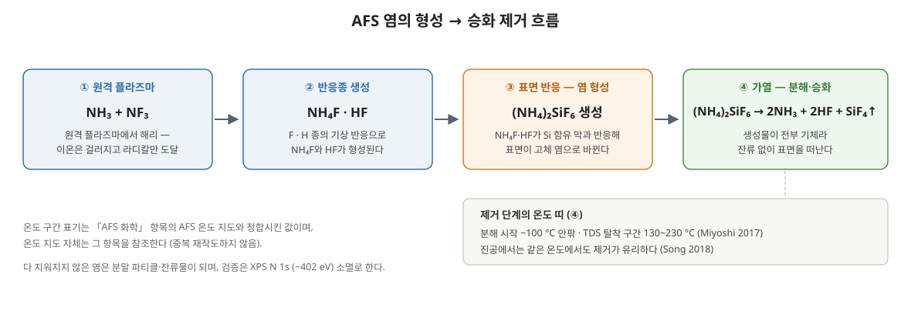

> 만들어진 (NH₄)₂SiF₆ 염을 남김없이 지우는 일 — 제거 경로 3가지와, 다 지워지지 않았을 때 생기는 잔류물·파티클 문제.

### 제거는 공정 창의 절반이다

[[AFS 선택 식각]]은 표면을 염으로 바꿨다가 날려 보내는 화학이다. 그런데 "날려 보내는" 쪽이 불완전하면 염은 그대로 결함이 된다 — 웨이퍼 위에 남은 염 분말, 식각을 방해하는 잔류물, 챔버 벽에 다시 생기는 재증착. 염을 쓰는 공정에서는 만드는 조건만큼 지우는 조건이 공정 창을 결정한다. 이 항목은 제거 경로와 잔류물의 문헌을 모은다.



### 제거 경로 1 — 열분해·승화

기본 경로는 가열이다. (NH₄)₂SiF₆는 가열하면 (NH₄)₂SiF₆ → 2NH₃ + 2HF + SiF₄로 분해되어 생성물이 전부 기체로 떠난다. 분해가 시작되는 온도는 100°C 안팎이다.

- **TDS가 보여주는 것** — Miyoshi(2017)는 승온 탈착 분광으로 탈착이 130~230°C 구간에서 일어남을 보이고(Fig. 7), 0차 탈착으로 해석한 활성화 에너지를 종별로 NH₃ 0.96, HF 0.85, SiF₃ 0.71 eV로 얻었다(Arrhenius, Fig. 8). 어닐 온도를 정하는 근거가 되는 숫자다.
- **승온 속도가 병목** — 제거 단계의 시간은 대개 탈착이 잡아먹는다. Miyoshi(2017)는 IR 램프 어닐로 150°C까지 10초 안에 승온해 탈착 시간을 크게 줄였다 — 사이클 처리량은 형성보다 제거에서 정해지는 경우가 많다.
- **진공 중 승화** — Song 등(2018)은 Si 위에 만든 (NH₄)₂SiF₆ 박막이 진공 챔버에서 100°C 이상 어닐로 승화 제거됨을 보였다. 압력이 낮을수록 분해 산물이 표면에서 빨리 빠져나가므로, 같은 온도라도 진공 조건이 제거에 유리하다.

### 메커니즘 — 탈착 속도는 무엇이 정하나

열 제거는 세 과정이 이어진 것이다. 염이 분해되어 NH₃·HF·SiF₄(TDS에서는 조각 SiF₃로 관측)가 되고, 이 분자들이 표면을 떠나며, 떠난 기체가 다시 표면이나 벽과 만나지 않고 배기된다. 셋 중 어느 하나가 막혀도 염은 남는다.

- **분해·탈착** — Miyoshi(2017)는 탈착을 0차로 해석했다. 0차 탈착은 속도가 남은 염의 양에 의존하지 않으므로, 다 지우는 시간은 대체로 염 층 두께에 비례한다. 자기제한으로 두께가 1~2 nm에 묶이는 사이클 공정(Miyoshi 2017, Fig. 9)에서 수 초 탈착이 가능한 이유이고, 두꺼운 분말이 오래 걸리는 이유다.
- **온도 민감도는 종마다 다르다** — 활성화 에너지가 다르면 같은 온도 변화에 대한 탈착 속도 변화도 다르다. 전지수 인자가 온도에 무관하다고 **가정**하고 100 °C에서 150 °C로 올릴 때의 속도 비를 Miyoshi(2017)의 종별 활성화 에너지로 **산술**하면 다음과 같다.

| 탈착 종 | 활성화 에너지 (Miyoshi 2017, Fig. 8) | 100 → 150 °C 속도 비 (산술) |
| --- | --- | --- |
| SiF₃ (SiF₄ 조각) | 0.71 eV | 약 14배 |
| HF | 0.85 eV | 약 23배 |
| NH₃ | 0.96 eV | 약 34배 |

```latex
\frac{r(T_2)}{r(T_1)} = \exp\!\left[\frac{E_a}{k_B}\left(\frac{1}{T_1}-\frac{1}{T_2}\right)\right]
```

활성화 에너지가 가장 큰 NH₃ 쪽이 온도에 가장 민감하다. 산술로 읽으면 어닐 온도가 낮을수록 NH₃ 탈착이 상대적으로 더 크게 늦어진다는 뜻이지만, 원문은 종별 탈착 순서까지 이 비로 주장하지 않는다. 이 표는 온도를 몇십 도 바꾸는 것이 탈착 시간에 자릿수 단위로 걸린다는 감각을 주는 용도다.

- **배기** — 떠난 분자가 차가운 벽이나 좁은 구조 안에서 다시 만나면 염이 재형성된다. 진공이 승화를 돕는 것(Song 2018)과, 고종횡비 패턴 안쪽에 염이 남기 쉬운 것은 모두 이 세 번째 과정의 문제다([[진공 흐름·기체 수송]]).

&#91;embedded content: IR 어닐과 염의 소멸 · Miyoshi (2017) 재구성]

[[AFS 화학]]의 XPS 지문 그림이 "염이 생겼다·사라졌다"를 보여 준다면, 이 그림은 "가열하면 얼마나 빨리 사라지는가"를 보여 준다 — 제거 단계의 처리량을 정하는 쪽이다. 원본은 Miyoshi(2017)의 IR 어닐 시간에 따른 N 1s 스펙트럼 그림(Fig. 6)이다.

### 제거 경로 2 — 수세 용해

(NH₄)₂SiF₆는 물에 녹는다. 그래서 열로 다 날리지 못한 염은 DIW 세정으로 씻어내는 경로가 있다.

Kwon과 Park(2022)은 HF VPD(기상 식각)를 거친 Si₃N₄ 웨이퍼의 (NH₄)₂SiF₆ 분말을 대상으로 **완전 제거 조건**을 정량했다 — 진공 오븐에서 170°C·120초·120 Torr 가열한 뒤, 25°C DIW로 30초 세정하면 분말이 완전히 사라진다. 가열만으로, 또는 세정만으로는 부족하고 두 단계를 조합한 조건이라는 점이 포인트다(Table 1, Fig. 3·4). 용매는 IPA 등 다른 후보와 비교 평가한 끝에 DIW가 선택됐다.

### 제거 경로 3 — 화학으로 되돌리기

- **수분의 도움** — Lill 등(2024)의 DFT 계산은 H₂O가 AFS의 결합을 약화시킴을 보였다(결합 에너지 0.47 → 0.35 eV, 계산값). 제거 단계에 수분을 쓰는 설계가 분해 온도를 낮출 여지를 주는 근거다.
- **재노출·재형성 사이클** — 제거가 덜 된 표면을 다시 약한 형성 조건에 노출했다가 탈착시키는 반복은, 잔류 염을 조금씩 걷어내는 방식으로 쓸 수 있다. 다만 사이클마다 모재도 조금씩 깎이므로 마진 계산이 필요하다.

### 경로 비교와 배치 — 어디서 지우나

| 경로 | 구동력 | 강점 | 약점 |
| --- | --- | --- | --- |
| 열분해·승화 | 온도 (100~230 °C) | 잔류 없이 전부 기체로, 사이클 안에 넣기 쉬움 | 탈착 시간이 처리량 병목, 열 예산 소모 |
| 수세 용해 | DIW 용해 | 열로 안 지워진 분말까지 확실히 제거 (Kwon & Park 2022) | 습식 단계 추가, 건조·워터마크 관리 |
| 화학 보조 | H₂O 등에 의한 결합 약화 | 분해 온도를 낮출 여지 (DFT 근거) | 조건 창이 좁고 설계 근거가 아직 계산 수준 |

배치 방식도 갈린다. 형성한 그 챔버에서 그대로 가열해 날리는 **in-situ 제거**는 사이클 구조와 궁합이 좋고 이송 오염이 없지만, 챔버가 탈착 시간만큼 묶인다. 반대로 Kwon과 Park(2022)의 진공 오븐 + DIW처럼 **ex-situ 제거**로 빼면 식각 챔버 처리량은 지키면서 더 강한 조건(고온 장시간 + 수세)을 쓸 수 있는 대신, 염이 남은 채로 웨이퍼를 옮기는 구간의 파티클·재증착 관리가 새로 생긴다. 실제 공정 설계는 대개 in-situ 탈착을 기본으로 두고, 잔류가 쌓이는 조건에서 ex-situ 완전 제거를 백업으로 얹는 형태가 된다.

### 논문을 한 표에 모으면

제거 조건과 그 결과를 문헌별로 모았다. 대상 막과 형성 방식이 달라 행끼리 수치를 비교하는 표가 아니다. 원문 위치는 Joy의 원문 추출(2026-11-01)을 따른다.

| 논문 | 대상 | 형성 | 제거 | 정량 결과 | 원문 위치 |
| --- | --- | --- | --- | --- | --- |
| Miyoshi 2017 | Si₃N₄ | HFC 리모트 플라즈마 300 s | IR 어닐, 150 °C까지 10 s 승온 | EPC 1.6 nm/cycle, SiO₂ 무식각, 개질층 10 s 안에 완전 제거 | Fig. 4·6 |
| Miyoshi 2017 (TDS) | 개질층 | 위와 같음 | 승온 탈착 | 탈착 130~230 °C, Eₐ NH₃ 0.96 · HF 0.85 · SiF₃ 0.71 eV (0차), 개질층 1~2 nm 다층 | Fig. 7·8·9 |
| Song 2018 | Si | O₂ 산화 + NH₃/NF₃ 개질 | 진공 중 100 °C 승화 | EPC 0.28 nm/cycle, 염 두께가 사이클 수에 선형 | Fig. 1·6(a) |
| Kim 2017 | PSZ·TEOS·열산화막·ALD 산화막 | NF₃/H₂O 혼합 플라즈마 (기존 NF₃/NH₃ 공정의 잔류물을 피하려는 설계) | — (잔류물 거동 관찰) | 식각률의 시간 거동이 막마다 갈림: TEOS 감소, 열산화·ALD 일정, PSZ 최저 | 반응식 (1)·(2), Fig. 4 |
| Kwon & Park 2022 | Si₃N₄ (HF VPD 후) | HF 기상 식각 | 진공 오븐 170 °C·120 s·120 Torr + DIW 25 °C·30 s | 분말 317 → 2101개/mm² (Si₃N₄ 30 → 70 nm), 지름 약 10 µm, 100 nm에서 응집 약 30 µm | Fig. 2·3·4, Table 1 |
| Lill 2024 | AFS (계산) | — | H₂O 보조 | AFS 결합 에너지 0.47 eV, NH₄⁺를 H₃O⁺로 바꾸면 0.35 eV (DFT) | 본문 |

### 논문 사이의 긴장

- **10초인가, 수세까지인가.** Miyoshi(2017)는 IR 어닐 10 s로 개질층을 완전히 지웠지만, Kwon과 Park(2022)은 170 °C·120 s 가열로도 모자라 DIW 세정을 더해야 분말이 사라졌다. 두 결과는 모순이 아니라 지울 대상이 다르다. 앞은 자기제한으로 1~2 nm에 묶인 얇은 개질층이고, 뒤는 30~70 nm 막을 기상 식각하며 생긴 지름 10 µm급 분말이다. 0차 탈착이라면 지우는 시간은 양에 비례하므로, 염을 얇게 만드는 설계(사이클화)가 곧 제거를 쉽게 하는 설계다.
- **100 °C인가, 130 °C 이상인가.** Song(2018)은 진공 중 100 °C에서 승화 제거를, Miyoshi(2017)의 TDS는 130~230 °C 탈착 구간을 보고했다. 앞은 진공에서 시간을 들인 승화 조건이고, 뒤는 일정 속도로 온도를 올릴 때 탈착 신호가 나오는 구간이라 측정 방식이 다르다. 공정 온도를 정할 때는 「얼마나 오래 둘 수 있는가」와 함께 읽어야 한다.
- **잔류물은 막을 가린다.** Kim(2017)에서 같은 NF₃/H₂O 화학이라도 막마다 식각률의 시간 거동이 갈렸다. 잔류물이 쌓이는 막에서는 식각이 시간에 따라 느려지므로, 짧은 시간 식각률로 잰 선택비가 긴 공정에서는 유지되지 않을 수 있다.

### 잔류물 문제 — 무엇이 남고 무엇을 막나

**분말 파티클 (Kwon & Park 2022).** HF VPD를 거친 Si₃N₄ 웨이퍼 표면에는 지름 약 10 µm의 (NH₄)₂SiF₆ 분말이 생긴다. 밀도는 Si₃N₄ 두께가 30 nm에서 70 nm로 두꺼워지는 구간에서 **317 → 2101개/mm²**로 늘었고(Fig. 2), 100 nm에서는 분말이 약 30 µm로 뭉쳤다 — 깎인 양(생성된 염의 양)이 많을수록 남는 분말도 많고 커진다는 뜻이다.

**반응 잔류물 (Kim 2017).** Kim 등(2017)은 NF₃/H₂O 화학으로 폴리실라잔(PSZ)을 건식 식각할 때 생기는 (NH₄)₂SiF₆ 잔류물(제목의 「ammonium silicate」)을 특성화했다. 서론에서 소개한 기존 NF₃/NH₃ 공정이 이 잔류물을 남기는 문제가 있어, 본 연구는 H₂O를 쓰는 화학으로 바꿨다. 이 잔류물은 표면에 남아 뒤이은 식각 반응 자체를 방해한다 — 식각이 중간에 느려지거나 멈추는 양상으로 나타나며, 잔류물의 양은 공정 파라미터에 따라 달라져 관리 대상이 된다.

**그 밖에 남는 문제들.**

- **후속 공정 오염** — 남은 염은 후속 증착의 계면 오염·접착 불량이 되고, 가열 공정에서 늦게 분해되며 HF·NH₃를 방출해 주변 막을 공격할 수 있다.
- **재증착** — 분해 산물인 NH₃·HF가 차가운 벽이나 배기 라인에서 다시 만나면 그 자리에 염이 다시 생긴다. 파티클과 챔버 메모리 효과의 공급원이 된다.
- **고종횡비 구조의 잔류** — 트렌치·홀 안쪽은 탈착 산물의 확산이 느려 같은 조건에서도 바깥 평면보다 염이 남기 쉽다.

### 제거 조건 설계·트러블슈팅

| 증상 | 의심 원인 | 대응 방향 |
| --- | --- | --- |
| 웨이퍼 표면 분말 파티클 | 탈착 온도·시간 부족, 생성 염 과다 | 어닐 온도·시간 상향 (IR 급속 승온), Kwon & Park 조건(진공 오븐 170 °C·120 s·120 Torr + DIW 25 °C·30 s) 같은 열+수세 조합 |
| 식각 도중 속도 저하·정지 | 잔류물이 표면을 덮어 반응 차단 (Kim 2017형) | 수분·온도 조건 조정으로 잔류물 생성 자체를 억제, 중간 탈착 단계 삽입 |
| 챔버 벽·배기 쪽 재증착 | 분해 산물의 재결합, 냉점 존재 | 벽 온도·배기 컨덕턴스 관리, 주기적 챔버 클리닝 |
| 패턴 안쪽만 염 잔류 | 고종횡비에서의 확산 제한 | 탈착 시간 연장, 압력을 낮춰 확산 유리하게 |
| 후속 막의 계면 결함 | 제거 불완전 후 증착 진행 | 증착 전 표면 확인(XPS N 1s 402 eV 소멸 여부)과 제거 조건 재검증 |

제거 검증의 1차 도구는 [[AFS 화학]]에서 다룬 XPS 지문이다 — 어닐 후 N 1s의 약 402 eV 피크가 사라졌는지가 "다 지워졌는가"를 판정한다.

## 근거

- TDS 탈착 구간·활성화 에너지·IR 어닐 — 실측: Miyoshi et al. (2017). DOI: [10.7567/JJAP.56.06HB01](https://doi.org/10.7567/JJAP.56.06HB01). 진공 중 승화 — Song et al., *Jpn. J. Appl. Phys.* 57, 106505 (2018). DOI: [10.7567/JJAP.57.106505](https://doi.org/10.7567/JJAP.57.106505).
- 완전 제거 조건·분말 밀도 317→2101개/mm² — 실측: Kwon & Park (2022), J. Korean Phys. Soc. 81, 903. DOI: [10.1007/s40042-022-00625-5](https://doi.org/10.1007/s40042-022-00625-5) (원문 대조 확인).
- (NH₄)₂SiF₆ 잔류물 특성화(NF₃/H₂O 화학, 제목의 ammonium silicate) — 실측: Kim (2017), ECS Trans. 80(2), 211. DOI: [10.1149/08002.0211ecst](https://doi.org/10.1149/08002.0211ecst).
- 결합 에너지 저하 0.47 → 0.35 eV — DFT 계산값(실측 아님): Lill et al. (2024). DOI: [10.1116/6.0004019](https://doi.org/10.1116/6.0004019).
- 통합 표·긴장 절의 조건·수치·그림 번호는 Joy의 원문 추출(자료 패키지 2, 2026-11-01)을 따른다. 탈착 속도 비 표는 Miyoshi(2017)의 활성화 에너지에 전지수 인자 일정을 가정한 산술이다.

## 관련 항목

- [[AFS 화학]] — 염의 형성·분해 화학
- [[AFS 선택 식각]] — 염을 쓰는 선택 식각 공정
- [[세정]] — 수세 제거와 건식 프리클린의 자리
