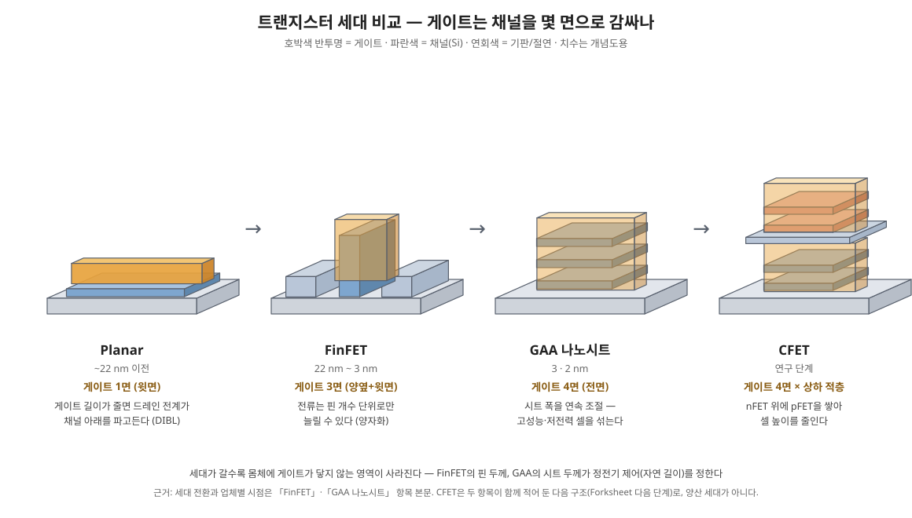

> 채널을 게이트가 사방으로 감싸는 나노시트 트랜지스터의 구조와 제조 흐름, 그리고 다음 단계.

GAA(Gate-All-Around)는 게이트가 채널을 4면 모두 감싸는 트랜지스터로, 3nm·2nm급 최신 로직 공정의 표준 구조다. 이 장은 GAA가 왜 필요한지, 어떻게 만드는지, 그 중 핵심 단계인 리세스 공정을 다룬다.

### GAA란 무엇이고 왜 필요한가

트랜지스터는 게이트 전압으로 채널 전류를 켜고 끄는 스위치다. 게이트 길이가 짧아지면 드레인 전계가 채널에 직접 영향을 줘, 게이트가 꺼져 있어도 전류가 새는 **단채널 효과**(DIBL, 누설전류 증가)가 생긴다. 게이트가 채널을 감싸는 면이 넓을수록 통제력(정전기적 제어)이 강해져 더 짧은 게이트에서도 확실히 끌 수 있다.

- **Planar → [[FinFET]]**: 채널을 세워 핀(fin)으로 만들고 게이트가 3면을 감쌌다.
- **FinFET의 한계**: 핀을 더 얇고 높게 만들기 어렵고, 전류를 늘리려면 핀 개수를 늘려야 해 구동력이 정수 단위로만 조절된다(양자화).
- **GAA의 해법**: 채널을 얇은 판(나노시트)으로 눕혀 여러 장 쌓고 게이트가 각 시트를 완전히 둘러싼다. 시트 폭을 연속적으로 바꿀 수 있어 저전력(좁게)과 고성능(넓게) 설계가 자유롭다.

회사별 이름은 다르다 — 삼성 MBCFET(3nm급 최초 양산), TSMC N2 나노시트, Intel RibbonFET(20A/18A).

### GAA 공정 흐름

GAA는 "희생층을 넣어 두었다가 나중에 빼고 그 자리에 게이트를 채우는" 방식으로 만든다. [[절연막]]·[[반도체·채널 물질]]을 비롯한 재료 항목들의 물질 대부분이 이 흐름에 등장한다.

1. **Si/SiGe 초격자 에피** — Si와 SiGe를 수 nm씩 번갈아 쌓는다. Si는 채널, SiGe는 희생층이 된다.
2. **핀 패터닝 + STI** — 적층막을 핀 모양으로 식각하고 산화막으로 분리한다.
3. **더미 poly 게이트 + 게이트 스페이서** — 게이트 자리를 임시로 잡는다.
4. **S/D 리세스** — 게이트 양옆의 적층을 수직으로 파낸다. (11-3 ①)
5. **SiGe 측면 리세스** — 드러난 SiGe 끝만 옆으로 파낸다. (11-3 ②)
6. **내부 스페이서 증착 + 에치백** — 오목부에 절연막을 채운다. (11-3 ③)
7. **S/D 에피** — 캐비티에 Si:P(NMOS) / SiGe:B(PMOS)를 키운다.
8. **더미 게이트 제거 → 채널 릴리스** — 남은 SiGe 희생층을 Si에 대해 선택적으로 모두 제거해 시트를 띄운다.
9. **HKMG 증착** — 시트 사이 수 nm 틈까지 ALD로 HfO₂와 일함수 금속을 감싸듯 채운다.
10. **MOL 이후** — 게이트 캡, 컨택 형성으로 이어진다.

### 공정 난제와 다음 단계

| 난제 | 관련 단계 | 왜 어려운가 |
| --- | --- | --- |
| SiGe : Si 선택 식각 | 측면 리세스, 채널 릴리스 | 측면으로만 수십 nm를 등방적으로 파면서 Si 손실·손상은 거의 없어야 함 |
| 리세스 깊이 균일도 | 측면 리세스 | 층마다 깊이가 다르면 시트마다 실효 게이트 길이가 달라짐 |
| 에피 두께·조성 균일도 | 초격자 에피 | 두께·Ge 농도 편차가 그대로 소자 편차와 식각 속도 편차로 이어짐 |
| 좁은 틈 속 ALD | HKMG | 시트 위·아래·옆의 막 두께가 같아야 문턱전압이 맞음 |
| 내부 스페이서 형상 | 증착 + 에치백 | 오목부를 빈틈없이 채우고 바깥은 깨끗이 걷어내야 함 |

**다음 구조.** nFET과 pFET 사이에 절연 벽을 세워 간격을 줄이는 **Forksheet**, nFET 위에 pFET을 수직으로 쌓는 **CFET**이 연구되고 있다. 둘 다 GAA의 시트 구조와 희생층·리세스 기법을 그대로 확장한다.

**참고 논문**

- [Stacked nanosheet gate-all-around transistor to enable scaling beyond FinFET](https://doi.org/10.23919/VLSIT.2017.7998183) — Loubet et al., Symp. VLSI Technol. (2017). 나노시트 GAA의 첫 실증 보고
- [Study of Silicon Nitride Inner Spacer Formation in Process of Gate-all-around Nano-Transistors](https://doi.org/10.3390/nano10040793) — Li et al., Nanomaterials 10, 793 (2020). SiN 내부 스페이서의 증착·에치백 공정 실험, 오픈액세스
- [Interest of SiCO low k=4.5 spacer deposited at low temperature (400°C) in the perspective of 3D VLSI integration](https://doi.org/10.1109/IEDM.2015.7409656) — Benoit et al., IEDM (2015), 8.6.1. SiN을 대체하는 저온 SiCO 스페이서

### 설계 변수 — 시트 치수가 소자를 정한다

| 변수 | 전형 범위 (교재·업계 전형값) | 늘리면 | 줄이면 |
| --- | --- | --- | --- |
| 시트 두께 (Tsi) | 약 5~7 nm | 구동전류 증가, 양자 구속 완화 | 정전기 제어 개선, 이동도·Vt 편차 민감 |
| 시트 폭 (W) | 수십 nm, 용도별 가변 | 유효 채널 폭 증가 → Ion 증가 | 누설·면적 감소, 저전력 설계 |
| 시트 장수 (스택 수) | 대개 3장 | 단위 면적당 전류 증가 | 공정 난도·기생 성분 증가 |
| 시트 간격 (수직 피치) | 대략 10 nm 안팎의 게이트 공간 | HKMG 금속이 들어갈 틈 확보 | 적층 밀도 증가, 게이트 충진 난도 상승 |

**정전기 제어의 핵심은 완전 공핍이다.** 시트 두께가 얇으면 채널 전체가 게이트 전계 안에 들어와 몸체 어딘가에서 전위가 떠 있는 영역이 남지 않는다. 그 결과 서브스레숄드 기울기가 이상값(상온 약 60 mV/dec)에 가까워지고 DIBL이 작아진다. FinFET에서 핀 두께가 하던 역할을 시트 두께가 이어받은 셈이며, 두께 편차가 곧 Vt 편차가 되므로 초격자 에피의 두께 균일도가 소자 산포를 정한다.

**폭의 연속 조절이 FinFET과의 결정적 차이다.** FinFET은 핀 개수로만 전류가 양자화됐지만, 나노시트는 폭을 리소그래피로 연속 조절할 수 있어 같은 셀 높이 안에서 고성능 셀(넓은 시트)과 저전력 셀(좁은 시트)을 섞는 DTCO가 가능하다.

### 스택 수와 간격의 트레이드오프

시트를 더 쌓으면 풋프린트당 유효 폭이 늘어 성능은 좋아지지만 대가가 따라온다. 초격자가 두꺼워지면 S/D 리세스와 채널 릴리스의 종횡비가 커지고, 아래쪽 시트일수록 릴리스 식각과 HKMG 충진이 어렵다. 시트 간격이 좁으면 일함수 금속을 넣을 공간이 부족해 multi-Vt 구현이 어려워지고(→ [[게이트 스택 (HKMG)]]의 다이폴 방식), 간격이 넓으면 적층 전체 높이가 커져 S/D 에피와 컨택 공정이 힘들어진다. 아래 시트와 기판 사이의 최하단 공간 처리(기생 채널 억제를 위한 절연 구조)도 스택 설계의 일부다.

### CFET으로 가는 길

CFET은 nFET 시트 스택 위에 pFET 스택을 수직으로 얹어 셀 높이를 줄이는 구조다. GAA의 초격자·릴리스·내부 스페이서 기술을 그대로 쓰지만, 위쪽 소자를 만들 때 아래쪽 소자가 견딜 열 예산, 상하 소자의 게이트·컨택 분리, 웨이퍼 뒤집어 붙이는 본딩 방식 등이 새 난제가 된다. Forksheet은 그 중간 단계로, n/p 사이에 절연 벽을 세워 간격을 FinFET 수준까지 좁히는 설계다. 두 구조 모두 "쌓는 방향으로 미세화를 계속한다"는 점에서 나노시트의 연장선에 있다.

### 모듈별 실측 — 문헌 통합

위의 흐름과 설계 범위는 교재 수준의 전형값이다. 아래 표는 같은 흐름의 각 모듈에서 실제로 보고된 수치를 모은 것이다. 업체 플랫폼 행은 발표 시점의 자사 이전 노드 대비 값이라, 회사끼리 비교하지 않는다.

| 문헌 | 모듈 | 무엇을 | 수치 | 위치 |
| --- | --- | --- | --- | --- |
| Loubet et al. (2017) | 전체 흐름 | 적층 나노시트 첫 실증 (IBM 등) | 내부 스페이서 약 5 nm, Lg 12 nm, CPP 44/48 nm, 릴리스는 기상 HCl | 본문 |
| Yao et al. (2026) | 초격자 에피 | RPCVD 분할 온도 성장 | 초기층 650 °C → 후단층 600 °C, 600 °C의 Ge 확산계수는 650 °C 값의 5.6–7 %. 하층 Ge가 설계 20 %에서 약 18.5 %로 희석 | 본문 (프리프린트) |
| Sun et al. (2024) | 측면 리세스·릴리스 | 원격 NF₃ 사이클 식각 | 0.98 nm/cycle, 캐비티 ≤5 ± 0.3 nm, 시트 폭 30–80 nm 동시 릴리스 | Fig. 5·6 |
| Sun et al. (2023) | 채널 릴리스 | 다단 릴리스 + 산화 처리 | 터널 41.93 nm에 Si 측벽 손실 0.25 nm (168:1, 깊이 ÷ 손실) | Fig. 4 |
| Lee et al. (2022) | 내부 스페이서 | TCAD 변동 민감도 | 하단 두께 변동 < 1 nm 요구 | 본문 |
| Park et al. (2023) | 적층 (3D 적층 FET) | 상하 S/D 절연 (삼성) | CPP 48 nm, Lg 13 nm, 시트 폭 35 nm. 절연층 리세스 전용 건식 식각 | Fig. 4 |
| Bae et al. (2018) | 플랫폼 | 삼성 3 nm MBCFET | SS 65 (n) / 67 (p) mV/dec, FinFET 대비 Ion +31 % (2018년 발표 기준) | 본문·Fig. 5 |
| Yeap et al. (2024) | 플랫폼 | TSMC N2 | N3 대비 속도 +15 % 또는 전력 −30 %, SRAM 약 38 Mb/mm² (2024년 12월 발표 기준) | 초록·본문 |

&#91;embedded content: GAA 모듈별 실측 수치 지도 · 재구성: Yao 2026, Sun 2023·2024, Loubet 2017, Lee 2022, Park 2023]

### 논문 사이의 긴장

- **릴리스 화학은 아직 하나로 수렴하지 않았다.** Loubet 2017은 기상 HCl로 시트를 띄웠다. Sun 2024는 서론에서 HCl 식각에 600–760 °C 열예산이 따르고, 습식은 반달형 전면과 모세관 고착 위험이 있다고 정리한 뒤 원격 플라즈마 사이클을 내놓는다. 같은 모듈에 열화학·습식·라디칼 세 갈래가 공존하며, 화학별 형상과 Vt 차이는 [[리세스와 채널 릴리스]]에 정리했다.
- **에피의 열이력이 식각 속도를 바꾼다(추론).** Yao 2026은 쌓는 동안의 열이력 때문에 하층 SiGe의 Ge가 20 %에서 약 18.5 %로 희석된다고 보고했다. SiGe 식각률이 Ge 조성에 거의 비례한다는 보고(Loubet 2019, [[리세스와 채널 릴리스]])와 겹치면, 같은 레시피에서 아래층 인덴트가 덜 파일 수 있다. 하단 스페이서의 변동 허용폭이 가장 좁다는 Lee 2022와 같은 자리다. 두 연구를 잇는 실측은 아직 없어 추론으로 남긴다.
- **플랫폼 숫자는 기준선이 다르다.** 삼성(Bae 2018)은 자사 FinFET 대비, TSMC(Yeap 2024)는 자사 N3 대비다. 「+31 %」와 「+15 %」를 나란히 놓고 우열을 말할 수 없다. 플랫폼 논문은 모듈 레시피를 공개하지 않으므로, 공정 수치는 학계·장비사 문헌(위 표의 Sun·Yao·Durfee 계열)에서 온다.
- **적층으로 가면 「절연」이 새 식각 모듈이 된다.** Park 2023의 상하 S/D 절연은 절연층을 정해진 깊이까지 리세스하는 건식 식각에 달려 있다. 측면 리세스와 같은 「중간에서 멈추는 식각」 문제가 수직 방향으로 한 번 더 생기는 셈이다.

### 근거

- 「모듈별 실측」 표와 그림의 수치는 Joy의 원문 추출 패키지 두 묶음(2026-11-02)을 따랐다. Sun 2024 [doi:10.3390/nano14110928](https://doi.org/10.3390/nano14110928), Sun 2023 [doi:10.3390/nano13030504](https://doi.org/10.3390/nano13030504), Lee 2022 [doi:10.3390/nano12193349](https://doi.org/10.3390/nano12193349), Park 2023 IEDM [doi:10.1109/IEDM45741.2023.10413694](https://doi.org/10.1109/IEDM45741.2023.10413694), Yao 2026 [doi:10.48550/arXiv.2605.05667](https://doi.org/10.48550/arXiv.2605.05667) — Joy Crossref·doi.org 대조(2026-11-02).
- Bae et al., IEDM (2018), Yeap et al., IEDM (2024)의 DOI는 대조 대기라 링크를 달지 않았다. 플랫폼 수치는 각 발표 시점 기준이며, 원문 추출에서 「대조 대기」로 표시된 수치(SF3 속도, 18A 상세 등)는 쓰지 않았다.
- Loubet 2017의 수치(내부 스페이서 약 5 nm, Lg 12 nm, CPP 44/48 nm, 기상 HCl 릴리스)는 Joy 딥리서치 보고서의 사본 열람 기록을 따랐다. 수치 위치는 원문 대조 대기다.
- 「에피 열이력 → 식각 속도」 긴장은 두 연구를 겹친 추론이며 직접 실측이 아니다.
- 공정 흐름과 첫 실증: Loubet et al., Symp. VLSI Technol. (2017) — 아래 참고 논문.
- 시트 두께·폭·스택 수 등 본문의 치수는 특정 업체의 양산 실측이 아니라 학회·교재에서 통용되는 **전형 설계 범위**다. 실제 값은 노드와 업체마다 다르며 비공개인 경우가 많다.

## 관련 항목

- [[리세스와 채널 릴리스]] — 나노시트를 띄우는 식각
- [[스페이서]] — 게이트 주변 절연 구조 전체 지도
- [[외부 스페이서]] — 게이트 측벽 스페이서와 소재 경쟁
- [[에어 스페이서]] — k = 1 스페이서의 실증과 한계
- [[내부 스페이서]] — GAA의 매립 절연막
- [[FEOL]] — GAA가 만들어지는 흐름
